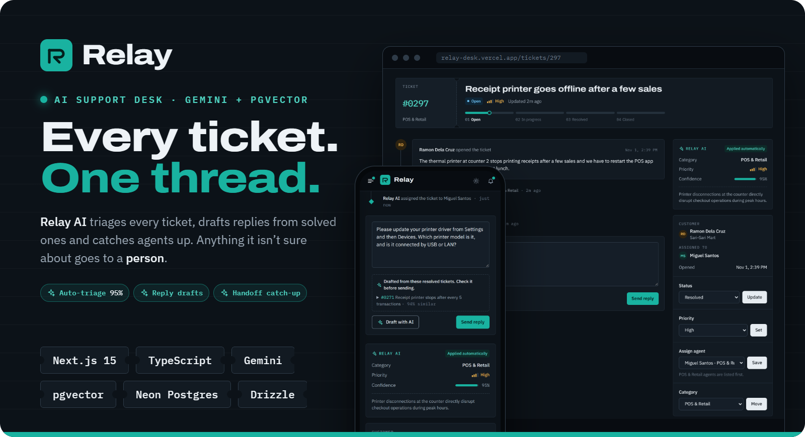
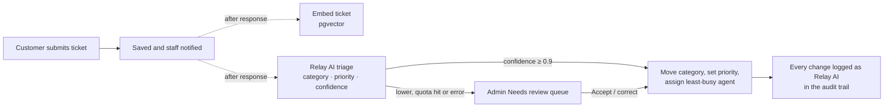

<p align="center">
  
</p>

##

<p align="center">
  
  
  
  
  
  
  
  
</p>

<h1 align="center">🎫 Relay</h1>

<p align="center">
  <b>Relay</b> is a support desk for customers, agents and admins, built with <b>Next.js</b>, <b>Drizzle ORM</b> and <b>Neon Postgres</b>.<br/>
  <b>Relay AI</b> triages every new ticket, drafts replies from similar resolved tickets and catches agents up on handoffs,<br/>
  and sends anything it isn't sure about to a person.
</p>

---

## ✨ Features

- 🎫 **Three roles, one thread**: customers raise and follow tickets, agents work their category's queue, admins assign work and manage the team
- 🤖 **Relay AI**: auto-triage with a human review queue, reply drafts from similar resolved tickets, and handoff summaries ([how it works](#-relay-ai))
- 🧾 **Audit trail and notifications** for every status, priority, assignment and category change
- 🔍 **Search and filters** by subject, customer or `#number`, kept in the URL so views can be shared
- 🌗 **Dark and light themes**, responsive down to phones
- 🧪 **Live demo** with shared customer, agent and admin accounts, reset daily

---

## 🤖 Relay AI

Relay AI is built into the existing workflow rather than bolted on as a chatbot. It runs on **Gemini's free tier** through the **Vercel AI SDK**, and every suggestion is either confident enough to act on or handed to a person.

| Feature | What happens | Who sees it |
| --- | --- | --- |
| **Auto-triage** | A second after a ticket is saved, Relay AI picks the category and priority with a confidence score. At ≥ 90% it moves the ticket, sets the priority and assigns the least-busy agent in that category. Below that, it waits in an admin **Needs review** queue with the suggestion ready to accept. | Admins and agents (customers just get routed faster) |
| **Reply drafts** | **Draft with AI** finds the most similar resolved tickets in the same category (embeddings + **pgvector** cosine search) and drafts a reply that leads with how they were fixed. The agent edits and sends it; it's never sent on its own. | Agents and admins |
| **Handoff catch-up** | When a ticket changes hands, the new agent gets a three-line summary: *problem, what's been tried, next step*. It can be refreshed when new messages arrive. | Agents and admins |
| **AI dashboard** | Share of tickets routed automatically, share sent to a person, how often staff corrected the AI, and time to triage. | Admins |



### Measured, not assumed

Triage is scored on a **hand-labelled set of 120 tickets** ([`evals/triage`](evals/triage)), 24 per category, with deliberately hard cases: tickets that fit two teams, Taglish, vague one-liners and tickets with several problems. Prompt changes and the confidence threshold were tuned on the 40-ticket dev split only; the 80-ticket test split is held out.

| Dev split (40 tickets), `gemini-3.5-flash-lite` | First prompt | With routing notes | Keyword baseline |
| --- | --- | --- | --- |
| Category accuracy | 92.5% | **100%** | 77.5% |
| Priority, exact | 70% | 70% | 47.5% |
| Priority, within one level | 100% | 100% | 97.5% |

```bash
npm run eval:triage                          # dev split
npm run eval:triage -- --test --confirm-test # held-out test split, run once
```

### Design decisions

- **Same code in production and the eval**: `classifyTicket` is a pure function, so the eval measures exactly what users get.
- **AI suggests, code decides**: the model picks category and priority; which agent gets the ticket is a plain rule (least-busy in the category), and assignment uses the same "still unassigned" guard as claiming, so a person always wins a race.
- **Never in the way**: triage, embeddings and summaries run after the response (`next/server` `after()`), so customers never wait on the model. With no API key Relay runs exactly as before.
- **Free-tier aware**: every call is logged; per-user and site-wide daily limits keep the public demo inside Gemini's free quota, and hitting a limit falls back to the human path. `gemini-3.5-flash-lite` was chosen because `gemini-3.5-flash` allows only about 20 free requests a day.
- **Private by default**: drafts only see the *staff* replies of other tickets, never other customers' details, and customers never see AI internals.
- **Measured thresholds**: the 0.65 similarity cut-off for "similar tickets" comes from the demo data (unrelated pairs scored 0.58–0.63, related ones 0.67–0.71).

---

## 🔒 Security

- Every server action checks the signed-in user and their role; ticket access goes through one permissions module
- Tickets you can't see return 404, the same as tickets that don't exist
- bcrypt password hashing, signed `httpOnly` session cookies, hashed reset codes compared in constant time
- Password reset with hashed 6-digit email codes: 10-minute expiry, 5 attempts, 3 codes per hour
- Sign-in and reset responses don't reveal which emails have accounts
- Shared demo accounts can't change their email or password, and demo agents can't be removed

---

## 🌐 Demo

🔗 **Live Demo**: [Relay](https://relay-desk.vercel.app) (resets daily)

Jump straight in as a [customer](https://relay-desk.vercel.app/demo/customer), an [agent](https://relay-desk.vercel.app/demo/agent) or an [admin](https://relay-desk.vercel.app/demo/admin).

---

## ⚡ Quick Start

Follow these steps to get a local copy of the project up and running.

### 1️⃣ Clone the repository

```bash
git clone https://github.com/Renz-Eryll/Relay.git
cd Relay
```

### 2️⃣ Environment setup

```bash
cp .env.example .env.local   # or: vercel env pull .env.local
```

For Relay AI, add a free `GEMINI_API_KEY` from [Google AI Studio](https://aistudio.google.com) (no card needed). Without it the AI features are simply hidden.

### 3️⃣ Install dependencies and set up the database

```bash
npm install
npm run db:setup   # enable pgvector (once)
npm run db:push    # create tables
npm run db:seed    # optional: demo workspace with 6 staff, 5 customers and 26 tickets
npm run ai:embed   # optional: embed existing tickets for similar-ticket search
```

### 4️⃣ Start the development server

```bash
npm run dev
```

Open **http://localhost:3000** in your browser to view Relay.

| Script | What it does |
| --- | --- |
| `npm run dev` | Development server |
| `npm run build` | Production build (type-checks and lints) |
| `npm run db:push` | Sync the Drizzle schema to the database |
| `npm run db:seed` | Recreate the demo workspace |
| `npm test` | Unit tests (Vitest) |
| `npm run eval:triage` | Score AI triage on the labelled dataset |
| `npm run ai:embed` | Embed tickets that don't have a vector yet |

---

## 🗂️ Project Structure

```
src/
  app/
    (app)/          signed-in pages: dashboard, queue, tickets, categories, agents, notifications, settings
    actions/        server actions (auth, tickets, people, ai), each validated with Zod and permission-checked
    api/cron/       daily demo reset (then triages the fresh open tickets)
  db/               Drizzle schema, client, seed, pgvector setup and embedding backfill
  lib/              auth, permissions, data access, notifications, mail
    ai/             Relay AI: provider and limits, triage, embeddings and similar tickets, drafts, summaries
  components/       UI building blocks
evals/triage/       labelled dataset, eval runner, metrics and reports
```

CI runs lint, typecheck, unit tests and a production build on every pull request.

---

## 📜 History

Relay is my own rewrite of the support-ticketing system I built with my team during our internship
(React + Laravel + MySQL: [PerezJY/Ticketing-System](https://github.com/PerezJY/Ticketing-System), with Jenny Rose Perez, Jowen, Precious, Katherine and Kyle).
It keeps the same roles and workflow, with a new codebase, a single TypeScript stack, proper authorization on every action,
one notifications model instead of three, an audit trail, and a public demo.

---

## 📧 Contact

- **Name**: Renz Eryll Ramelo
- **LinkedIn**: [www.linkedin.com/in/renz-eryll-ramelo](https://www.linkedin.com/in/renz-eryll-ramelo)
- **GitHub**: [https://github.com/Renz-Eryll](https://github.com/Renz-Eryll)
