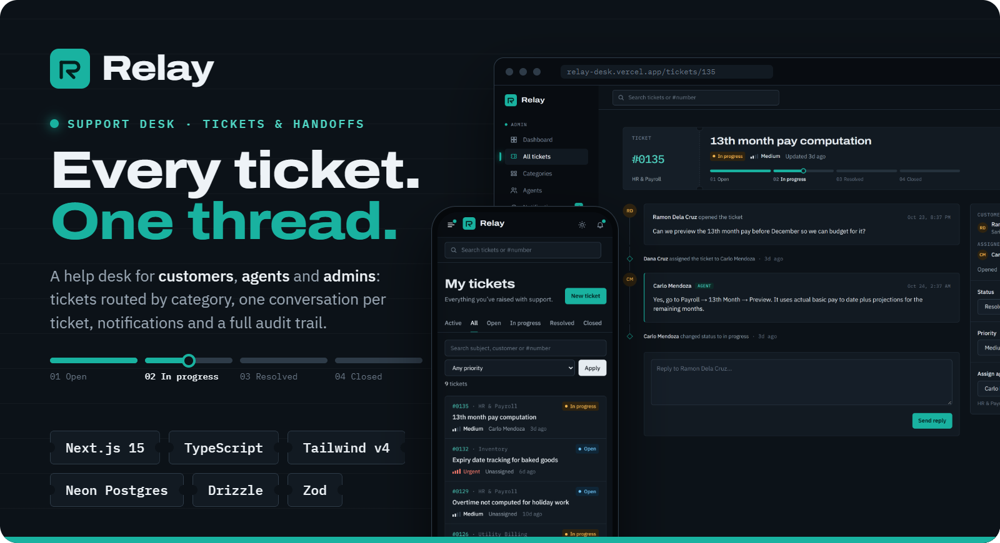

<p align="center">
  
</p>

##

<p align="center">
  
  
  
  
  
  
</p>

<h1 align="center">🎫 Relay</h1>

<p align="center">
  <b>Relay</b> is a support desk for customers, agents and admins, built with <b>Next.js</b>, <b>Drizzle ORM</b> and <b>Neon Postgres</b>.<br/>
  Tickets are routed by category, each one keeps a single conversation thread, and every change lands in an audit trail.
</p>

---

## ✨ Features

- 🙋 **Customers**: raise a ticket in one of five categories with a priority, follow status and replies in one thread, close it or reopen it if the problem comes back
- 🎧 **Agents**: a queue for their category with tickets assigned to them plus unassigned ones they can claim; reply, set priority and move tickets through open → in progress → resolved → closed
- 🛠️ **Admins**: dashboard of open, in-progress and unassigned work, average resolution time and load per agent; assign tickets (agents in the ticket's category are suggested first), manage categories and agents
- 🔔 **Notifications** for new tickets, replies, assignments and status changes
- 🧾 **Audit trail** on every ticket: who changed the status, priority or assignee, and when
- 🔑 **Password reset** with a 6-digit email code (10-minute expiry, 5 attempts, 3 codes per hour)
- 🔍 **Search** by subject, customer or `#number`; filters live in the URL so views can be shared
- 🌗 **Dark and light themes**, with a slide-in menu on phones
- 🧪 **Demo mode**: shared customer, agent and admin accounts, reset by a daily cron

---

## 🔒 Security

- Every server action checks the signed-in user and their role; ticket access goes through one permissions module
- Tickets you can't see return 404, the same as tickets that don't exist
- bcrypt password hashing, signed `httpOnly` session cookies, hashed reset codes compared in constant time
- Sign-in and reset responses don't reveal which emails have accounts
- Shared demo accounts can't change their email or password, and demo agents can't be removed

---

## 🌐 Demo

🔗 **Live Demo**: [Relay](https://relay-desk.vercel.app) (resets daily)

Jump straight in as a [customer](https://relay-desk.vercel.app/demo/customer), an [agent](https://relay-desk.vercel.app/demo/agent) or an [admin](https://relay-desk.vercel.app/demo/admin).

---

## ⚡ Quick Start

Follow these steps to get a local copy of the project up and running.

### 1️⃣ Clone the repository

```bash
git clone https://github.com/Renz-Eryll/Relay.git
cd Relay
```

### 2️⃣ Environment setup

```bash
cp .env.example .env.local   # or: vercel env pull .env.local
```

### 3️⃣ Install dependencies and set up the database

```bash
npm install
npm run db:push    # create tables
npm run db:seed    # optional: demo workspace with 6 staff, 5 customers and 26 tickets
```

### 4️⃣ Start the development server

```bash
npm run dev
```

Open **http://localhost:3000** in your browser to view Relay.

| Script | What it does |
| --- | --- |
| `npm run dev` | Development server |
| `npm run build` | Production build (type-checks and lints) |
| `npm run db:push` | Sync the Drizzle schema to the database |
| `npm run db:seed` | Recreate the demo workspace |

---

## 🗂️ Project Structure

```
src/
  app/
    (app)/          signed-in pages: dashboard, queue, tickets, categories, agents, notifications, settings
    actions/        server actions (auth, tickets, people), each validated with Zod and permission-checked
    api/cron/       daily demo reset
  db/               Drizzle schema, client and seed script
  lib/              auth, permissions, data access, notifications, mail
  components/       UI building blocks
```

---

## 📜 History

Relay is my own rewrite of the support-ticketing system I built with my team during our internship
(React + Laravel + MySQL: [PerezJY/Ticketing-System](https://github.com/PerezJY/Ticketing-System), with Jenny Rose Perez, Jowen, Precious, Katherine and Kyle).
It keeps the same roles and workflow, with a new codebase, a single TypeScript stack, proper authorization on every action,
one notifications model instead of three, an audit trail, and a public demo.

---

## 📧 Contact

- **Name**: Renz Eryll Ramelo
- **LinkedIn**: [www.linkedin.com/in/renz-eryll-ramelo](https://www.linkedin.com/in/renz-eryll-ramelo)
- **GitHub**: [https://github.com/Renz-Eryll](https://github.com/Renz-Eryll)
